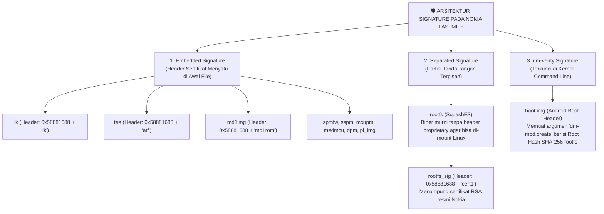
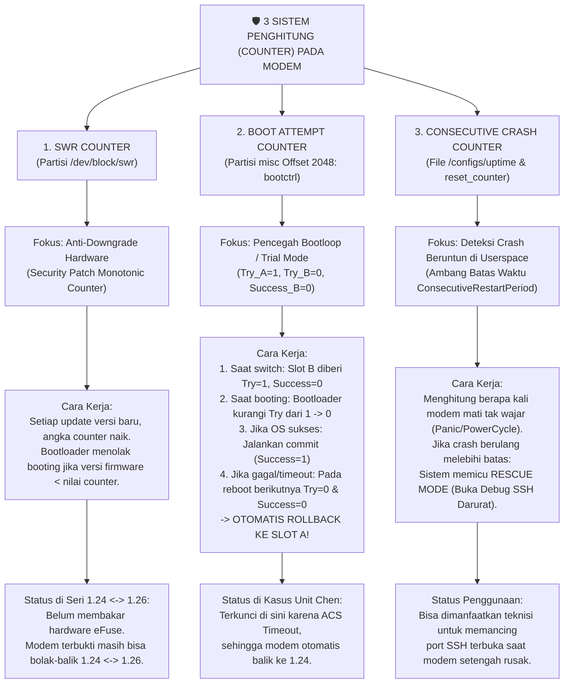
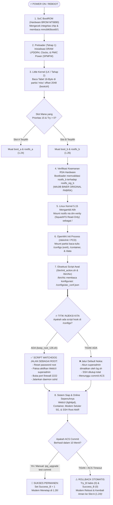
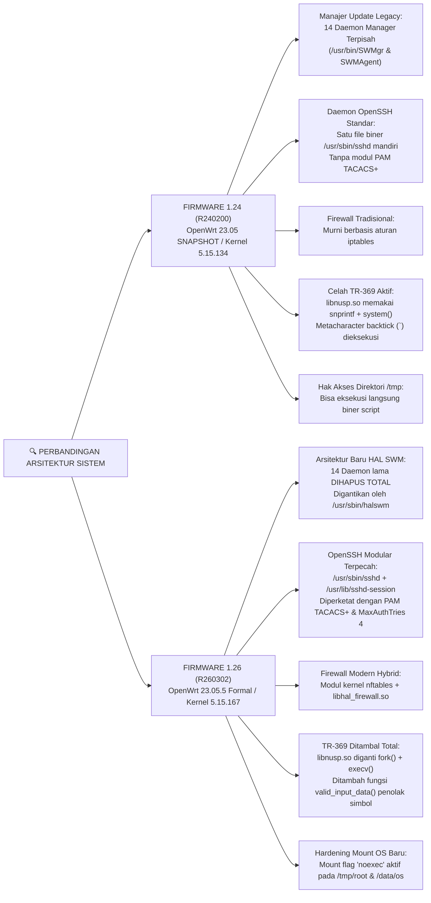

# 📊 INFOGRAFIS & PANDUAN LENGKAP: ARSITEKTUR PARTISI, COUNTER, SIGNATURE, & BOOTFLOW NOKIA FASTMILE 5G

> **Target Perangkat:** Nokia FastMile 5G Gateway 2 (`5GGW2-OMNI-2`)  
> **Chipset Utama:** MediaTek MT6890 (Dimensity T750 CPE / Cortex-A55 AArch64)  
> **Media Penyimpanan:** Chip Flash eMMC (Sistem Dual-Slot A/B)  
> **Referensi Dump Fisik:** `H:\Nokia\Dump\mine\` (51 File Partisi Lengkap)

---

## 🌳 BAGAN 1: POHON HIRARKI SELURUH PARTISI eMMC (INFOGRAFIS LENGKAP)

Bagan visual seluruh partisi eMMC yang dipetakan secara komprehensif berdasarkan perannya di hardware dan software:

```mermaid
flowchart TD
    ROOT["💾 CHIP eMMC FLASH STORAGE\n(Nokia FastMile 5GGW2-OMNI-2)"]

    %% CABANG UTAMA
    ROOT --> B_HW["1. HARDWARE BOOT BLOCKS\n(Partisi Fisik Khusus eMMC)"]
    ROOT --> B_AB["2. DUAL-SLOT A/B SYSTEM\n(16 Pasang Partisi OS & Radio)"]
    ROOT --> B_UNIK["3. DATA UNIK PABRIK & SECURITY\n(Non-A/B / Kunci Hardware)"]
    ROOT --> B_RUN["4. RUNTIME, CONTAINER & SETTING\n(Read-Write, Docker & Counter)"]

    %% SUB-CABANG 1: HW BOOT
    B_HW --> HW1["mmcblk0boot0 : Preloader Slot A (BRLYT Header)"]
    B_HW --> HW2["mmcblk0boot1 : Preloader Slot B (BRLYT Header)"]

    %% SUB-CABANG 2: DUAL SLOT A/B
    B_AB --> AB_CORE["A. OS & Kernel Core"]
    AB_CORE --> P_BOOT["boot_a / boot_b\n(Kernel Linux 5.15 + dm-verity)"]
    AB_CORE --> P_ROOT["rootfs_a / rootfs_b\n(SquashFS Read-Only OS)"]
    AB_CORE --> P_SIG["rootfs_sig_a / rootfs_sig_b\n(Sertifikat RSA 'cert1' Resmi Nokia)"]

    B_AB --> AB_LOAD["B. Bootloader & Keamanan"]
    AB_LOAD --> P_LK["lk_a / lk_b\n(Little Kernel Stage 2 - Magic 0x58881688)"]
    AB_LOAD --> P_TEE["tee_a / tee_b\n(ARM TrustZone ATF OS - Magic 0x58881688)"]
    AB_LOAD --> P_LEXT["loader_ext_a / loader_ext_b\n(Secondary DRAM Loader)"]

    B_AB --> AB_MODEM["C. Modem Radio 5G"]
    AB_MODEM --> P_MD1["md1img_a / md1img_b\n(Firmware Baseband MT6890 / md1rom)"]
    AB_MODEM --> P_DSP["md1dsp_a / md1dsp_b\n(DSP Pemroses Sinyal Radio)"]
    AB_MODEM --> P_MCF1["mcf1_a / mcf1_b\n(Modem Carrier Profile Utama)"]
    AB_MODEM --> P_MCF2["mcf2_a / mcf2_b\n(Carrier Aggregation Config)"]

    B_AB --> AB_PWR["D. Manajemen Daya & MCU"]
    AB_PWR --> P_SPM["spmfw_a/b : System Power Management"]
    AB_PWR --> P_SSPM["sspm_a/b : Secure Power Processor"]
    AB_PWR --> P_MCU["mcupm_a/b & medmcu_a/b : MediaTek MCU"]
    AB_PWR --> P_DPM["dpm_a/b & pi_img_a/b : Peripheral Power & Board"]

    %% SUB-CABANG 3: DATA UNIK & SECURITY
    B_UNIK --> U_MIM["Factory_MIM (1 MiB)\n(SN, MAC Address, IMEI, Default WiFi Key)"]
    B_UNIK --> U_PRO["proinfo (3 MiB)\n(MediaTek Hardware ID & Seri Chip)"]
    B_UNIK --> U_CAL["nvram & nvdata & nvcfg (masing-masing 32 MiB)\n(Kalibrasi Daya Radio RF Pabrik & Data SIM)"]
    B_UNIK --> U_PROT["protect1 & protect2 (masing-masing 8 MiB)\n(Proteksi Radio Seluler & Backup Identitas IMEI)"]
    B_UNIK --> U_SEC["seccfg (512 KiB)\n(Security Config Magic 'MMMM' - Bootloader Lock)"]
    B_UNIK --> U_INFO["flashinfo (16 MiB)\n(Geometri eMMC, Sektor & Bad Block Table)"]

    %% SUB-CABANG 4: RUNTIME, CONTAINER & SETTING
    B_RUN --> R_CONT["container (1 GiB)\n(Subsistem Docker / Kubernetes / Bitdefender)"]
    B_RUN --> R_CFG["configs (20 MiB ext4)\n(Database WebUI, Script Kustom, Hook Root)"]
    B_RUN --> R_DAT["user_data (1.5 GiB ext4)\n(Log Sistem /data, Cache Unduhan OTA CloudFront)"]
    B_RUN --> R_BCFG["BootConfig (1 MiB)\n(NVRAM Boot Magic 0xafafafaf - ActiveGroup/Commit)"]
    B_RUN --> R_MISC["misc (512 KiB)\n(Tabel Penentu Slot Aktif: bootctrl offset 2048)"]
    B_RUN --> R_SWR["swr (233 MiB)\n(Safe Hardware Rollback Counter)"]
    B_RUN --> R_PARA["para & boot_para (512 KiB & 2 MiB)\n(Parameter Boot Fastboot & Hardware Crash Counter)"]
    B_RUN --> R_EXP["expdb (20 MiB)\n(Exception Database - RAM Dump Kernel Panic)"]
```

---

## 📝 DAFTAR & FUNGSI LENGKAP SELURUH PARTISI eMMC (51 FILE DUMP)

Berdasarkan hasil pembacaan fisik langsung pada direktori dump `H:\Nokia\Dump\mine\`:

### 1. Kelompok Hardware Boot & Secondary Loaders
| Partisi | Ukuran File | Header / Magic | Fungsi Teknis |
|---|:---:|:---:|---|
| **`mmcblk0boot0`** | 256 KiB | `BRLYT` | **Preloader Slot A**: Bootloader tahap 1 yang diinisialisasi langsung oleh BootROM silikon CPU. |
| **`mmcblk0boot1`** | 256 KiB | `BRLYT` | **Preloader Slot B**: Salinan preloader cadangan untuk dual-boot A/B. |
| **`loader_ext_a/b`** | 262 KiB | `0x58881688` (`loader_ext_dram`) | Driver inisialisasi memori LPDDR4 tahap kedua sebelum kontrol diserahkan ke LK. |

### 2. Kelompok Sistem Operasi, Kernel & Keamanan (Dual-Slot A/B)
| Partisi | Ukuran File | Header / Magic | Fungsi Teknis |
|---|:---:|:---:|---|
| **`boot_a/b`** | 32 MiB | `ANDROID!` | **Kernel Linux 5.15**: Mengandung kernel biner dan instruksi `dm-verity` untuk mount rootfs. |
| **`rootfs_a/b`** | 130 MiB | `0x73717368` (`sqsh`) | **SquashFS Root Filesystem**: Berisi seluruh file sistem operasi, daemon OpenWrt, dan utilitas. |
| **`rootfs_sig_a/b`** | 512 KiB | `0x58881688` (`cert1`) | **Sertifikat RSA Nokia**: Tanda tangan digital resmi untuk memverifikasi integritas `rootfs`. |
| **`lk_a/b`** | 1 MiB | `0x58881688` (`lk`) | **Little Kernel (LK)**: Bootloader tahap 2 pengatur booting OS, LED, dan pembaca `bootctrl`. |
| **`tee_a/b`** | 1 MiB | `0x58881688` (`atf`) | **ARM TrustZone TEE OS**: Lingkungan eksekusi terisolasi untuk kunci enkripsi dan DRM. |
| **`seccfg`** | 512 KiB | `0x4d4d4d4d` (`MMMM`) | **Security Config**: Mengatur status kunci verifikasi bootloader (Locked / Unlocked). |

### 3. Kelompok Radio Modem 5G & Power Management (Dual-Slot A/B)
| Partisi | Ukuran File | Header / Magic | Fungsi Teknis |
|---|:---:|:---:|---|
| **`md1img_a/b`** | 80 MiB | `0x58881688` (`md1rom`) | **Firmware Baseband 5G**: Sistem operasi inti modem seluler MediaTek MT6890. |
| **`md1dsp_a/b`** | 10 MiB | `0x58881688` (`md1dsp`) | **DSP Radio**: Program pemrosesan sinyal digital radio 4G LTE dan 5G NR. |
| **`mcf1_a/b`** | 8 MiB | Raw Data | **Modem Carrier Profile 1**: Konfigurasi band seluler operator utama (misal `IDIO` / `FWAG`). |
| **`mcf2_a/b`** | 8 MiB | Raw Data | **Modem Carrier Profile 2**: Konfigurasi tabel agregasi operator seluler sekunder. |
| **`spmfw_a/b`** | 1 MiB | `0x58881688` (`spmfw`) | **System Power Management Firmware**: Pengatur tegangan daya dan PMIC SoC. |
| **`sspm_a/b`** | 1 MiB | `0x58881688` (`tinysys-sspm`) | Co-processor manajemen daya terisolasi. |
| **`mcupm_a/b`** | 1 MiB | `0x58881688` (`tinysys-mcupm-RV`) | Firmware Microcontroller Power Management berbasis arsitektur RISC-V. |
| **`medmcu_a/b`** | 1 MiB | `0x58881688` (`tinysys-medmcu-R`) | Firmware kontroler MediaTek MCU internal. |
| **`dpm_a/b`** | 1 MiB | `0x58881688` (`dpmpm`) | **Device Power Management**: Driver daya periferal board. |
| **`pi_img_a/b`** | 1 MiB | `0x58881688` (`pi_img`) | **Platform Image**: Konfigurasi hardware spesifik board Nokia FastMile. |

### 4. Kelompok Data Unik Fisik & Kalibrasi Hardware (Haram Dihapus/Ditimpa)
| Partisi | Ukuran File | Format | Fungsi Teknis |
|---|:---:|:---:|---|
| **`Factory_MIM`** | 1 MiB | Key-Value String | **Sertifikat Fisik Pabrik**: Menyimpan Nomor Seri (SN), MAC Address, IMEI, dan WPA Key default. |
| **`proinfo`** | 3 MiB | Raw Data | **Product Information**: Hardware ID MediaTek dan nomor seri chip silikon unik. |
| **`nvram`** | 32 MiB | Binary Structure | **Kalibrasi RF Pabrik**: Nilai kompensasi Power Amplifier antena seluler per unit. |
| **`nvdata`** | 32 MiB | Binary Structure | **Data Dinamis Radio**: Histori koneksi kartu SIM dan status band locking runtime. |
| **`nvcfg`** | 32 MiB | Binary Structure | Konfigurasi non-volatile driver radio modem. |
| **`protect1`** | 8 MiB | Backup Block | Salinan proteksi partisi radio seluler dan data integritas IMEI. |
| **`protect2`** | 8 MiB | Backup Block | Cadangan proteksi sekunder radio modem. |
| **`flashinfo`** | 16 MiB | Hardware Map | Informasi geometri chip eMMC, ukuran erase block, dan tabel bad block. |

### 5. Kelompok Runtime, Container, & Pengaturan Pengguna
| Partisi | Ukuran File | Format | Fungsi Teknis |
|---|:---:|:---:|---|
| **`container`** | **1 GiB** | ext4 | **Docker / Kubernetes (k3s)**: Ruang container terisolasi untuk modul pihak ketiga (misal antivirus Bitdefender atau analitik operator). |
| **`configs`** | 20 MiB | ext4 | **Database Pengaturan Pengguna**: Tempat tersimpannya setelan WiFi, database TR-069, dan hook root kita (`/configs/aic_conf.json`). |
| **`user_data`** | 1.5 GiB | ext4 | **Penyimpanan Lokal /data**: Menampung log sistem, riwayat koneksi, dan file unduhan OTA CloudFront. |
| **`BootConfig`** | 1 MiB | NVRAM (`0xafafafaf`) | Menyimpan variabel boot low-level seperti `ActivePartitionGroup`, `PltCommit`, dan status aktivasi slot. |
| **`misc`** | 512 KiB | Raw Table | **Tabel Boot Control (`bootctrl`)**: 16 byte pada offset `2048` menentukan slot mana yang aktif dan sisa jatah boot `Try`. |
| **`swr`** | 233 MiB | Raw Data | **Safe Hardware Rollback Counter**: Penyimpan monotonic counter anti-rollback versi firmware. |
| **`para` & `boot_para`** | 512 KiB & 2 MiB | Raw Data | Parameter boot fastboot dan counter kegagalan hardware berulang. |
| **`expdb`** | 20 MiB | Raw Log | **Exception Database**: Tempat kernel mencatat *RAM dump* otomatis saat terjadi *Kernel Panic*. |

---

## 🔐 ANALISIS SIGNATURE: APAKAH HANYA `rootfs` YANG MEMILIKI SIGNATURE?

**Jawabannya: TIDAK. Hampir SELURUH biner sistem memiliki Signature/Sertifikat!**

### Mengapa Signature `rootfs` Harus Dipisah ke `rootfs_sig`?
1. Partisi seperti `lk`, `tee`, dan `md1img` dijalankan langsung oleh bootloader MediaTek, sehingga MediaTek bisa menambahkan header sertifikat proprietary (`0x58881688`) pada sektor `0x00` file tersebut.
2. Namun `rootfs` adalah **filesystem Linux standar (SquashFS)**. Jika disisipkan header biner 512-byte di awal filenya, driver `mount -t squashfs` di kernel Linux akan gagal mengenali superblock filesystem (`magic 0x73717368`).
3. Oleh sebab itu, Nokia memisahkan sertifikat kriptografinya ke partisi tersendiri: **`rootfs_sig_a/b`** (berisi sertifikat `cert1`).

---

## ⏱️ MEMBEDAH 3 SISTEM COUNTER DI MODEM NOKIA

Modem ini memiliki 3 penghitung (*counter*) keamanan independen untuk mencegah kerusakan sistem dan manipulasi software:

---

## 🚀 ALUR BOOTING LENGKAP & TITIK INJEKSI HOOK (BOOTFLOW)

Bagan langkah-demi-langkah sejak listrik dinyalakan hingga WebUI aktif:

---

## ⚖️ CABANG PERBEDAAN ARSITEKTUR BOOT & OS: 1.24 VS 1.26

