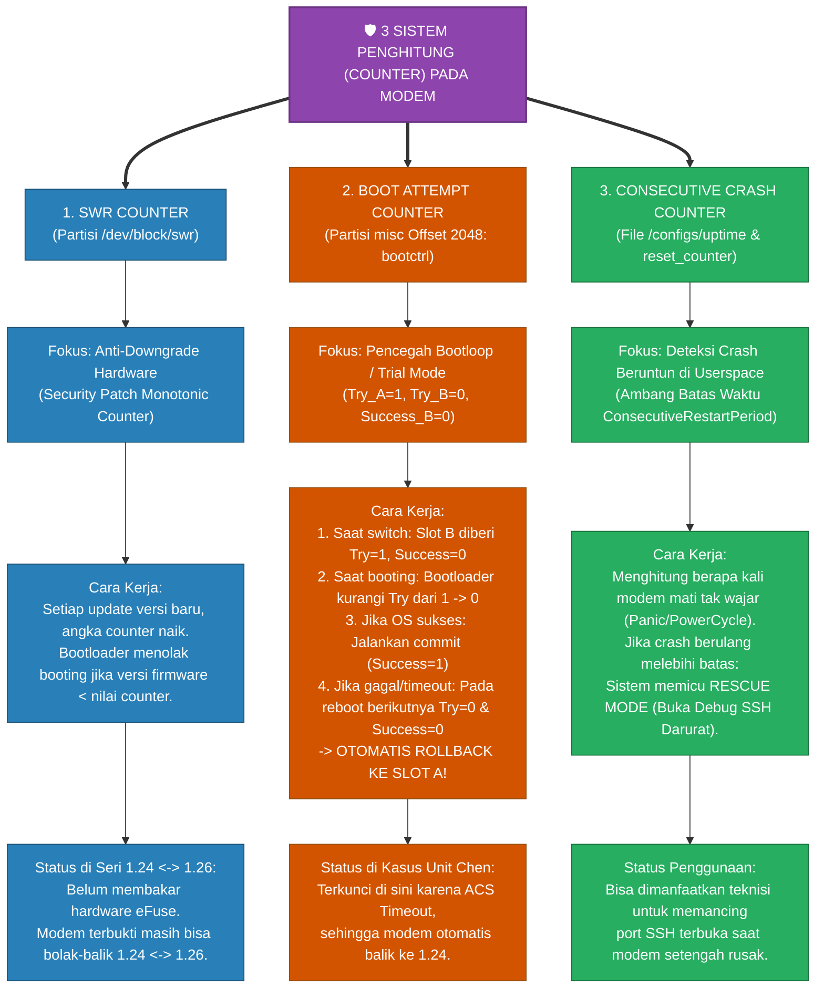
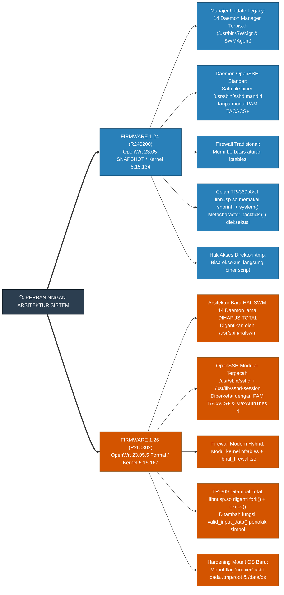

# 📊 INFOGRAFIS & PANDUAN LENGKAP: ARSITEKTUR PARTISI, COUNTER, & BOOTFLOW NOKIA FASTMILE 5G

> **Target Perangkat:** Nokia FastMile 5G Gateway 2 (`5GGW2-OMNI-2`)  
> **Chipset Utama:** MediaTek MT6890 (Dimensity T750 CPE / Cortex-A55 AArch64)  
> **Media Penyimpanan:** Chip Flash eMMC (Sistem Dual-Slot A/B)

---

## 🌳 BAGAN 1: POHON HIRARKI SELURUH PARTISI eMMC (INFOGRAFIS)

Berikut adalah bagan visual struktur seluruh partisi eMMC yang dikelompokkan berdasarkan fungsinya:

```mermaid
flowchart TD
    ROOT["💾 CHIP eMMC FLASH STORAGE\n(Nokia FastMile 5GGW2-OMNI-2)"]

    %% CABANG UTAMA
    ROOT ==> B_HW["1. HARDWARE BOOT BLOCKS\n(Partisi Fisik Khusus eMMC)"]
    ROOT ==> B_AB["2. DUAL-SLOT A/B SYSTEM\n(16 Pasang Partisi OS & Radio)"]
    ROOT ==> B_UNIK["3. DATA UNIK PABRIK\n(Non-A/B / Kunci Hardware)"]
    ROOT ==> B_RUN["4. RUNTIME & PENGATURAN\n(Read-Write & Counter)"]

    %% SUB-CABANG 1: HW BOOT
    B_HW --> HW1["mmcblk0boot0 : Preloader Slot A"]
    B_HW --> HW2["mmcblk0boot1 : Preloader Slot B"]

    %% SUB-CABANG 2: DUAL SLOT A/B
    B_AB --> AB_CORE["A. OS & Kernel Core"]
    AB_CORE --> P_BOOT["boot_a / boot_b\n(Kernel Linux 5.15 + Initramfs)"]
    AB_CORE --> P_ROOT["rootfs_a / rootfs_b\n(SquashFS Read-Only OS)"]
    AB_CORE --> P_SIG["rootfs_sig_a / rootfs_sig_b\n(Tanda Tangan RSA Resmi Nokia)"]

    B_AB --> AB_LOAD["B. Bootloader & Keamanan"]
    AB_LOAD --> P_LK["lk_a / lk_b\n(Little Kernel - Bootloader Tahap 2)"]
    AB_LOAD --> P_TEE["tee_a / tee_b\n(ARM TrustZone Secure OS)"]
    AB_LOAD --> P_LEXT["loader_ext_a / loader_ext_b\n(Secondary DRAM Loader)"]

    B_AB --> AB_MODEM["C. Modem Radio 5G"]
    AB_MODEM --> P_MD1["md1img_a / md1img_b\n(Firmware Baseband MT6890)"]
    AB_MODEM --> P_DSP["md1dsp_a / md1dsp_b\n(DSP Pemroses Sinyal Radio)"]
    AB_MODEM --> P_MCF1["mcf1_a / mcf1_b\n(Modem Carrier Profile Utama)"]
    AB_MODEM --> P_MCF2["mcf2_a / mcf2_b\n(Carrier Aggregation Config)"]

    B_AB --> AB_PWR["D. Manajemen Daya & MCU"]
    AB_PWR --> P_SPM["spmfw_a/b : System Power Management"]
    AB_PWR --> P_SSPM["sspm_a/b : Secure Power Processor"]
    AB_PWR --> P_MCU["mcupm_a/b & medmcu_a/b : MediaTek MCU"]
    AB_PWR --> P_DPM["dpm_a/b & pi_img_a/b : Peripheral Power & Board"]

    %% SUB-CABANG 3: DATA UNIK
    B_UNIK --> U_MIM["Factory_MIM\n(SN, MAC Address, IMEI, Default WiFi Key)"]
    B_UNIK --> U_PRO["proinfo\n(MediaTek Hardware ID & Seri Chip)"]
    B_UNIK --> U_CAL["nvram & nvdata & nvcfg\n(Kalibrasi Daya Radio RF Pabrik & Data SIM)"]
    B_UNIK --> U_SEC["protect1 & protect2 & seccfg\n(Proteksi Partisi Radio & Kunci Security Boot)"]

    %% SUB-CABANG 4: RUNTIME
    B_RUN --> R_CFG["configs (ext4)\n(Pengaturan WebUI, Script Kustom, Hook Root)"]
    B_RUN --> R_DAT["user_data (ext4)\n(Log Sistem /data, Cache OTA CloudFront)"]
    B_RUN --> R_MISC["misc (Raw 16-byte)\n(Tabel Penentu Slot Aktif: bootctrl)"]
    B_RUN --> R_SWR["swr (Raw Counter)\n(Safe Hardware Rollback Counter)"]
    B_RUN --> R_EXP["expdb & boot_para\n(Database Kernel Panic & Counter Boot Crash)"]

    %% STYLING
    classDef rootStyle fill:#2c3e50,stroke:#1a252f,stroke-width:2px,color:#fff;
    classDef mainBranch fill:#34495e,stroke:#2c3e50,stroke-width:2px,color:#fff;
    classDef osStyle fill:#2980b9,stroke:#1f618d,stroke-width:1px,color:#fff;
    classDef radioStyle fill:#16a085,stroke:#117864,stroke-width:1px,color:#fff;
    classDef factoryStyle fill:#c0392b,stroke:#922b21,stroke-width:1px,color:#fff;
    classDef configStyle fill:#d35400,stroke:#a04000,stroke-width:1px,color:#fff;

    class ROOT rootStyle;
    class B_HW,B_AB,B_UNIK,B_RUN mainBranch;
    class P_BOOT,P_ROOT,P_SIG,P_LK,P_TEE,P_LEXT osStyle;
    class P_MD1,P_DSP,P_MCF1,P_MCF2 radioStyle;
    class U_MIM,U_PRO,U_CAL,U_SEC factoryStyle;
    class R_CFG,R_DAT,R_MISC,R_SWR,R_EXP configStyle;
```

---

### 📝 Rincian Detail Fungsi Setiap Cabang Partisi

| Kelompok Cabang | Karakteristik Utama | Risiko Flashing / Modifikasi |
|---|---|---|
| **1. Hardware Boot (`boot0/boot1`)** | Terletak di blok boot hardware eMMC independen. Memuat Preloader pertama kali saat listrik masuk. | **FATAL**: Jika rusak, modem mati suri (*Hard Brick*) dan hanya bisa diselamatkan via Test Point (EDL) MediaTek. |
| **2. Dual-Slot A/B (16 Pasang)** | Menampung seluruh OS Linux, kernel, driver modem seluler 5G, dan tanda tangan digital RSA. | **SANGAT AMAN**: Jika satu slot rusak/gagal boot, sistem otomatis mundur (*rollback*) ke slot sebelahnya. |
| **3. Data Unik Pabrik (`Factory_MIM`, `nvram`)** | Berisi sertifikat fisik, kalibrasi sinyal RF antena per unit, IMEI, dan MAC address. | **JANGAN PERNAH DIHAPUS/DITIMPA**: Jika hilang, modem kehilangan sinyal seluler (*No Service*) dan IMEI menjadi `null`. |
| **4. Runtime & Setting (`configs`, `misc`)** | Partisi *read-write* ext4 dan penanda boot control. Tempat tersimpannya setelan WiFi, database TR-069, dan script user. | **AREA BEBAS MODIFIKASI**: Tempat kita menanam hook root dan script kustom tanpa merusak tanda tangan RSA hardware. |

---

## ⏱️ BAGAN 2: MEMBEDAH 3 SISTEM COUNTER DI MODEM NOKIA

Modem ini memiliki 3 penghitung (*counter*) keamanan independen untuk mencegah kerusakan sistem dan manipulasi software:

---

## 🚀 BAGAN 3: ALUR BOOTING LENGKAP & TITIK INJEKSI HOOK (BOOTFLOW)

Bagan berikut memetakan alur sejak tombol power ditekan hingga WebUI menyala, serta **posisi di mana script kita menyusup secara legal**:

```mermaid
flowchart TD
    START(["⚡ POWER ON / REBOOT"]) --> S1["1. SoC BootROM (Hardware BROM MT6890)\nMengecek integritas chip & membaca mmcblk0boot0/1"]
    
    S1 --> S2["2. Preloader (Tahap 1)\nInisialisasi DRAM LPDDR4, Clocks, & PMIC Power (SPMFW)"]
    
    S2 --> S3["3. Little Kernel (LK / Tahap 2)\nBaca Tabel 16-Byte di partisi 'misc' offset 2048 (bootctrl)"]
    
    S3 --> CHK_SLOT{"Slot Mana yang\nPrioritas 15 & Try > 0?"}
    
    CHK_SLOT -->|"Slot A Terpilih"| BOOT_A["Muat boot_a & rootfs_a (1.24)"]
    CHK_SLOT -->|"Slot B Terpilih"| BOOT_B["Muat boot_b & rootfs_b (1.26)"]
    
    BOOT_B --> S4["4. Verifikasi Keamanan RSA Hardware\nBootloader memvalidasi rootfs_b terhadap rootfs_sig_b\n(WAJIB BINER ORIGINAL PABRIK)"]
    
    S4 --> S5["5. Linux Kernel 5.15 Mengambil Alih\nMount rootfs (SquashFS Read-Only) sebagai /"]
    
    S5 --> S6["6. OpenWrt Init Process (/sbin/init / PCD)\nMount partisi baca-tulis: /configs (ext4) & /data"]
    
    S6 --> S7["7. Eksekusi Script Awal (/bin/init_action.sh & /bin/Aic)\n/bin/Aic membaca konfigurasi: /configs/aic_conf.json"]
    
    S7 ==> HOOK{"🔥 TITIK INJEKSI KITA\nApakah ada script hook di /configs?"}
    
    HOOK -->|"ADA (keep_root_126.sh)"| H_RUN["✅ SCRIPT WATCHDOG JALAN SEBAGAI ROOT:\n- Reset password root\n- Paksa aktifkan WebUI superadmin\n- Buka port firewall 2222\n- Jalankan daemon sshd"]
    HOOK -->|"TIDAK ADA"| H_DEF["❌ Jalur Default Nokia:\n- Akun superadmin dimatikan oleh bg.sh\n- SSH ditutup total\n- Menunggu commit ACS"]
    
    H_RUN --> S8["8. Sistem Siap & Online Sepenuhnya\nWebUI (lighttpd), Modem Seluler 5G, & SSH Root Aktif!"]
    H_DEF --> S8
    
    S8 --> CHK_COMMIT{"Apakah ACS Commit\nBerhasil dalam 10 Menit?"}
    
    CHK_COMMIT -->|"YA / Dijualankan Manual: ipq_upgrade test commit"| PASS["🎉 SUKSES PERMANEN:\nSet Success_B = 1\nModem Menetap di 1.26!"]
    CHK_COMMIT -->|"TIDAK / ACS Timeout"| FAIL["⚠️ ROLLBACK OTOMATIS:\nTry_B habis (0) & Success_B (0)\nModem Reboot & Kembali Aman ke Slot A (1.24)!"]

    %% STYLING
    classDef startStyle fill:#34495e,stroke:#2c3e50,stroke-width:2px,color:#fff;
    classDef stepStyle fill:#2980b9,stroke:#1b4f72,stroke-width:1px,color:#fff;
    classDef hookStyle fill:#d35400,stroke:#935116,stroke-width:2px,color:#fff;
    classDef passStyle fill:#27ae60,stroke:#196f3d,stroke-width:2px,color:#fff;
    classDef failStyle fill:#c0392b,stroke:#922b21,stroke-width:2px,color:#fff;

    class START startStyle;
    class S1,S2,S3,BOOT_A,BOOT_B,S4,S5,S6,S7,S8 stepStyle;
    class HOOK,H_RUN hookStyle;
    class PASS passStyle;
    class FAIL,H_DEF failStyle;
```

---

## ⚖️ BAGAN 4: CABANG PERBEDAAN ARSITEKTUR BOOT & OS: 1.24 VS 1.26

Berikut perbandingan visual langsung antara Firmware 1.24 lama dan 1.26 baru:

---

## 💡 KESIMPULAN STRATEGIS:

1. **Kenapa kita TIDAK BISA mengedit `rootfs_b.img` secara langsung?**  
   Karena pada **Bagan 3 (Langkah 4)**, bootloader melakukan verifikasi RSA digital signature terhadap partisi `rootfs_sig_b`. Mengubah satu byte isi SquashFS membuat hash tidak cocok dan booting dibatalkan seketika.
2. **Kenapa trik `/configs` SELALU BERHASIL?**  
   Karena pada **Bagan 1 (Cabang 4)**, partisi `/configs` berstatus ext4 baca-tulis biasa tanpa verifikasi signature hardware, dan pada **Bagan 3 (Langkah 7)**, proses resmi Nokia (`/bin/Aic`) sengaja membuka dan mengeksekusi script yang kita letakkan di sana.
3. **Bagaimana mengamankan akses di 1.26?**  
   Pastikan script watchdog Anda menyesuaikan perubahan di **Bagan 4**: membuka port via `iptables` sekaligus menangani arsitektur baru OpenSSH dan membalutnya dalam loop periodik agar tidak dimatikan paksa oleh sistem.
